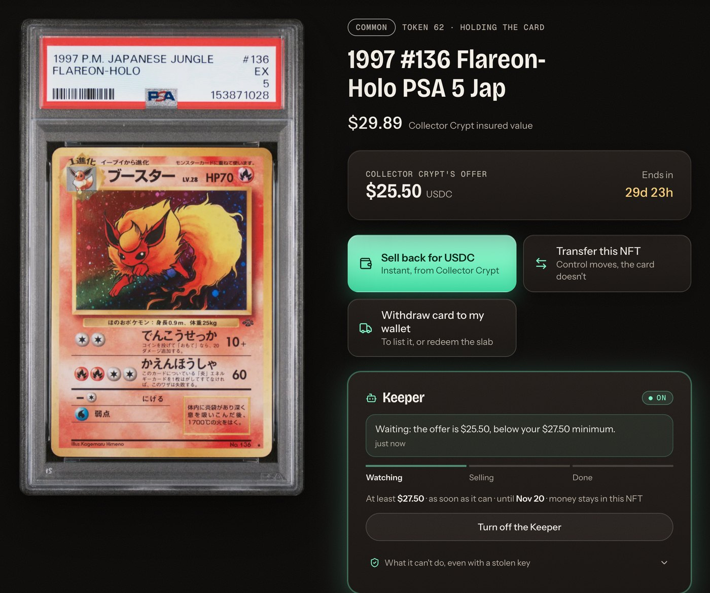
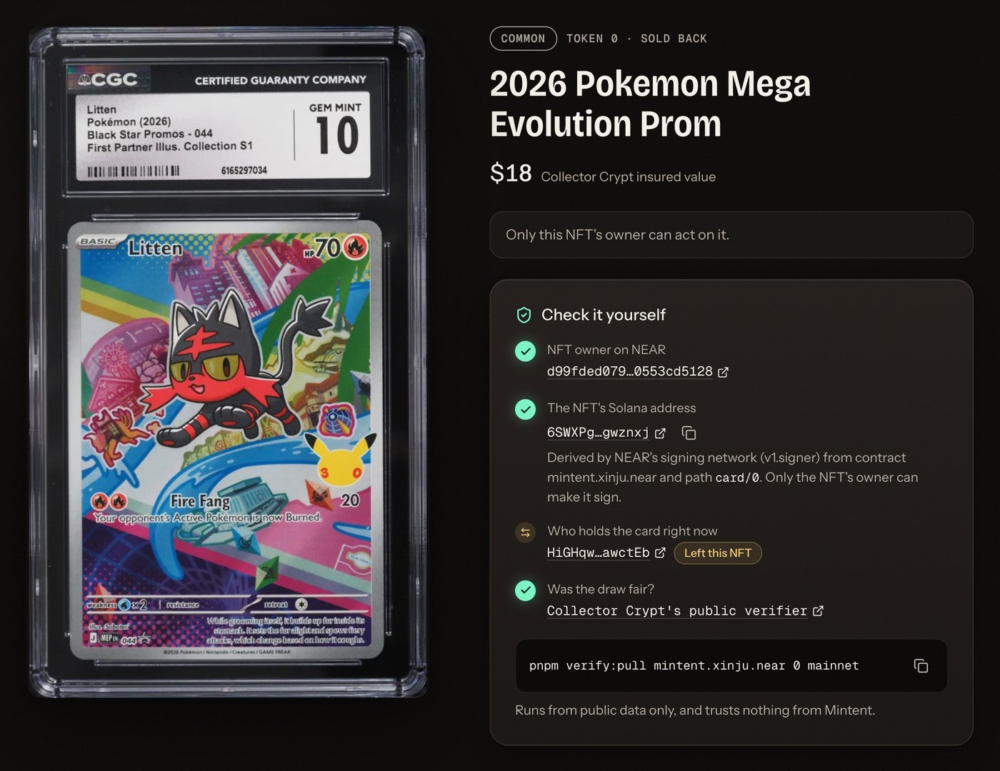
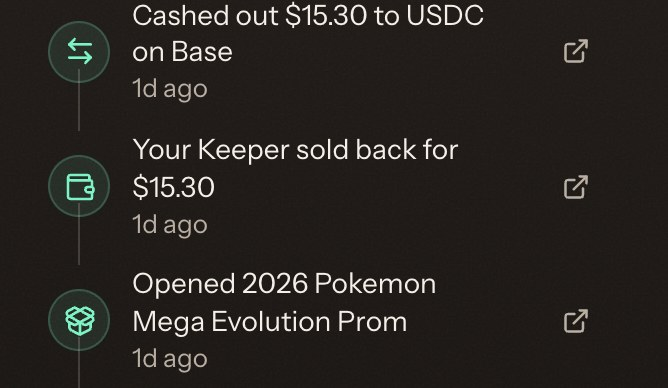

# Evidence: real runs you can check

Everything here happened on public test networks with no real money: NEAR testnet, Solana devnet, Collector Crypt's devnet and Tidepool (a community testnet of NEAR Intents 1Click). **Nothing has run on mainnet yet.** This file gets the mainnet hashes after that run.

## Re-check it without any credentials

```bash
pnpm install
pnpm test                                                          # contract, checkout and relayer tests
pnpm verify:pull mintent-con-mw7mmwr5.testnet 0                    # token sold back by its new owner
pnpm verify:pull mintent-con-mw7mmwr5.testnet 1                    # token whose owner withdrew the card to their own wallet
```

`verify:pull` reads only public data: NEAR RPC, Solana RPC and Collector Crypt's verifier. It trusts nothing from our relayer.

`pnpm test` needs Rust and `cargo-near` for the contract suite. The checkout and relayer suites need only Node.

## Full run from nothing, 8 Nov 2026: 23/23 checks in 6.3 minutes

Contract: `mintent-con-mw7mmwr5.testnet`, using the real testnet MPC network (`v1.signer-prod.testnet`). Throwaway accounts, created by the script.

| Step | What happened | Check it |
| --- | --- | --- |
| Checkout | Alice paid 25.57 test USDC through Tidepool. The treasury received exactly 25.25 on Solana (pack $25 + 1% fee), and the relayer proved that on-chain before minting | Order states in the demo log |
| Pull | Card delivered to token 0's MPC-derived address `FK4jAAZwHJgCKEKJkkLDzseootP6ojtptriWVMzfRRLB` | [Card asset](https://explorer.solana.com/address/FR2ckzK3V8TKYWBYuv5yDikcnmDHDfuKtUUwbdQrjXj5?cluster=devnet) |
| Fairness | Collector Crypt's VRF proof is valid for each pack | [Pack A](https://dev-gacha.collectorcrypt.com/verify-selection/cc-446470fa-4555-47b0-983a-e06f2540bf62), [Pack B](https://dev-gacha.collectorcrypt.com/verify-selection/cc-0236a840-9343-43fa-b3a7-9f62ac4fddfa) |
| **Attack refused** | Alice got a card transfer signed for token 1, then tried to sell the NFT. Refused: "token is locked: the card is leaving this address" | `pnpm test:contracts`, `attack_*` tests; live in `pnpm demo:testnet` |
| **Lingering rights refused** | Core delegate plugin, SPL Approve, a seller-owned durable nonce and a marketplace listing all refused by the live contract's policy | `check_card_message` on the contract |
| Handover | Token 0 moved from Alice to Bob on NEAR. The card didn't move on Solana. Alice's next signing request was rejected | `get_card` on the contract |
| Sell-back | Bob sold back through a Collector Crypt signed quote. The card returned to Collector Crypt and 53.55 USDC-Dev landed in the **NFT's own address** | [Tx `2d7rqzuc…`](https://explorer.solana.com/tx/2d7rqzuc8sdA9dhZEntJJsTeBVJpBj5tZY11Y6rnk7GMCLxZiHijvNFKn1ZrwvJZ2bJd4GPbkxXwqg6SYegy4WJA?cluster=devnet) |
| Withdraw proceeds | Bob moved the proceeds to his own Chain Signatures Solana address `58yehWNYRXnnwqadNaZjpbrsrEzKuQq54WyKLUP8SVEc` | [Tx `BJaKuBMa…`](https://explorer.solana.com/tx/BJaKuBMaiJQW67WwNXU5WzpnLJu1GcdvLUb66qrzLsubYnamVLuPeB9PWCo27R7o2ng6gpXbnzyEq57VE2iao5G?cluster=devnet) |

Then, in a follow-up run on the same contract:

| Step | What happened | Check it |
| --- | --- | --- |
| Withdraw card | Alice moved token 1's card to her own Solana address `5Di94YZHTJXofneJtFV4eaTA1oAukfQ79AqBbfcCQdZz`, and NEAR recorded the release. This is how an owner redeems the physical card on Collector Crypt's site, or lists it on a marketplace | [Tx `4dkX3PWn…`](https://explorer.solana.com/tx/4dkX3PWnm8ApuAPvtU5WduBewzQqpEiQ1v1vAsE6jgxvfkN34Xz5sAdPrHFMRMj3Zfa8tzGiuqvdZkPbzcwPxmNR?cluster=devnet) |

## The attack, before the fix

On the unprotected contract, `app2.mintent-dev-mw21w9ki.testnet`, the seller signed a transfer, sold the NFT to the buyer, then broadcast it. The buyer owned the NFT on NEAR, and the seller held the card on Solana: [tx `287sh1C2…`](https://explorer.solana.com/tx/287sh1C2HuCNznxsYBYvuKtZQ1zY3uUJoazEQ4strrkgsv15VUryMYEZfdU8svr4j7p4dCVxAZkaNThp4xsRLGge?cluster=devnet). The fix is in `docs/THREAT-MODEL.md`.

## Live checks against production (read-only, 8 Nov)

`scripts/src/mainnet-dry-check.ts` sends `dry: true` quotes to mainnet 1Click. No money moves. For a $50 pack + 1% (50.50 USDC on Solana):

| Pay with | Customer pays | Estimated time |
| --- | --- | --- |
| USDC on NEAR | ~$51.01 | 17 s |
| USDC on Arbitrum | ~$51.00 | 22 s |
| USDC on Base | ~$51.01 | 32 s |
| SOL | ~$51.11 | 17 s |
| ETH | ~$51.12 | 42 s |
| DOGE | ~$51.22 | 124 s |
| BTC | ~$51.13 | **802 s** |

## The web app in a real browser, 8 Nov

`apps/web/e2e/flow.mjs` drives real Chrome with two separate users on the same real test networks: 18 checks in 3.5 minutes, after the frontend rebuild. Ana's card is ready about 67 s after she pays (token 9). She tears the pack open, and her dashboard's vault value matches the card ($29.98). She gives the NFT to Ben, who starts with no NEAR. Ben sells it back at the quoted $25.50, his dashboard shows that USDC to withdraw, and he withdraws it. His activity then lists both, and Ana can no longer act on the card. The wall's images load in 1.6 s, and the pack is ready to open 3.8 s after the page arrives.

`apps/web/e2e/shots.mjs` checks each page at four screen sizes for console errors, sideways scrolling, small touch targets and whether the reveal's actions are on screen.

## Privy sign-in with a real login, 9 Nov

`apps/web/e2e/privy.mjs` drives real Chrome with a Privy test account, on the same test networks. Privy created the implicit NEAR account `9ed1b724cc85b4b7f30fd32bf8868aee0d6d177d4b3b0a259547565329cf631a`, and it stayed the same after a reload and after signing out and back in. Picking a pack while signed out opened checkout by itself after sign-in. That account bought token 11, then sold it back for $12.75 and withdrew the proceeds, in 2 minutes. Privy's key signed both NEAR transactions, and the account's on-chain nonce agrees. `pnpm verify:pull mintent-con-mw7mmwr5.testnet 11` passes from public data alone: the owner is that account, and the card went back to Collector Crypt.

`apps/web/e2e/signer.test.mts` checks offline that the signer's signature is identical to a local key's for the same transaction.

## A stuck paid order recovered by itself, 9 Nov

On 8 Nov, token 8's order stalled because the test treasury had run out, and it stayed stuck with no way to retry. After the recovery code (D-027) was deployed on 9 Nov, the relayer restarted that order at the right step without any manual action, bought exactly one pack and delivered the card. `pnpm verify:pull mintent-con-mw7mmwr5.testnet 8` passes: the card is at the token's address and the VRF proof is valid.

`services/relayer/test/relayer.test.ts` covers recovery with a mock of each failure: no second payment, no mint without settlement proof, and refunded orders staying final. `apps/web/e2e/stuck.mjs` checks what the customer sees, against stand-in relayer answers.

A full two-user run (buy, sell back, withdraw) used 0.0015 devnet SOL from the treasury, measured on 9 Nov. Treat that as a rough guide for mainnet, where fees and accounts may differ.

## Any-chain payment and cash-out, 9 Nov

`apps/web/e2e/anychain.mjs` drives the app's real screens on real test networks: 15 checks in 7.3 minutes.

| Step | What happened | Check it |
| --- | --- | --- |
| Pay from another chain | A throwaway wallet on Base Sepolia sent 25.56898 test USDC to the checkout's deposit address. Tidepool swapped it, the treasury received it on Solana, and the relayer proved that on-chain. Token 13 was delivered to the buyer's NEAR account, not to the paying wallet | [Payment on Base Sepolia](https://sepolia.basescan.org/tx/0x4c49ae3b52cba9df6d1331d922edb7bbe4b9872449d4a038eda794dfbdaa7ce7), [settlement on Solana](https://explorer.solana.com/tx/5bX8ZEJBapiviMnGdubCSNrKHdoLy8aevAzhR935H992xh5d3zXXHT5RFaqKdXEZtUfHC8cYemX9DnG3R2tYTtto?cluster=devnet) |
| Cash out to NEAR | Token 13's $15.30 sell-back became 15.26022 USDC on NEAR. The recipient's balance rose by exactly that, read from NEAR RPC | `ft_balance_of` on `usdc.tidepool-sandbox.testnet` |
| Cash out to Base | Token 14's $15.30 became 15.26022 USDC on Base Sepolia, at a fresh address that held nothing before, read from Base RPC | [`0x55528b52ab7000887f0bf1543c5b878c2cae66ca`](https://sepolia.basescan.org/address/0x55528b52ab7000887f0bf1543c5b878c2cae66ca) |

`apps/web/e2e/signin.mjs` covers sign-in against Privy's real service. A throwaway Ethereum wallet, injected the way MetaMask injects itself, signed Privy's real sign-in message, and Privy created NEAR account `32d2ac86…13f2`. The session survives a reload, the checkout offers that wallet as the refund address on a matching chain, a Bitcoin address is refused for a Base refund, and sign-out works for wallet, email and test accounts.

`scripts/src/mainnet-dry-check.ts` has read-only mainnet quotes for cashing out $100 of USDC from Solana (9 Nov). No money moves:

| Receive | About | Estimated time |
| --- | --- | --- |
| USDC on NEAR | $99.94 | 20 s |
| USDC on Base | $99.94 | 22 s |
| USDC on Arbitrum | $99.93 | 19 s |
| SOL | $99.99 | 17 s |
| ETH | $99.88 | 27 s |
| USDC on Ethereum | $99.64 | 27 s |
| DOGE | $99.67 | 162 s |
| BTC | $98.51 | 465 s |

An XRP quote failed with a 400 from 1Click, possibly because of the placeholder address used for it. Not investigated further. If it happens to a customer, they see a plain error before anything moves.

## A compromised relayer against the real app, 9 Nov

`apps/web/e2e/tamper.mjs` buys a real pack on test networks, then alters the browser's traffic to the relayer, so the prepared message sends the card to an address the owner never chose (token 16). The app refused and said why. **No transaction was sent to NEAR, the NFT stayed unlocked and the card didn't move.** The same withdrawal, unaltered, then went through the same check and the card reached the owner's address.

`apps/web/e2e/verify.test.mts` runs 11 offline tests of the check: swapped destinations, amounts, coins and cards, a card transfer hidden in a USDC transfer, extra steps, other signers and fee payers, foreign nonce accounts, lookup tables, trailing bytes and tampered quotes.

`scripts/src/spike-sellback-binding.ts` simulates tampered sell-backs against Collector Crypt's real devnet program, signing and sending nothing:

| Tampering | Result |
| --- | --- |
| None | Accepted |
| Card sent to another owner, in both instructions | Rejected: `DestinationNotAllowed` |
| Card sent elsewhere, payment unchanged | Rejected: `AssetNotDelivered` |
| Lower price | Rejected: `Ed25519MessageMismatch` |
| Money paid to another token account | Rejected: `AccountNotInitialized` (that account didn't exist, so the app checks this itself) |

## Proving payment without a reported hash, 9 Nov

`scripts/src/check-settlement-search.ts` runs the fallback search, read-only, against the real devnet treasury. It found the right transaction for 6 of 6 recent paid orders (tokens 10 to 15). `services/relayer/test/relayer.test.ts` covers the refusals: one transaction can't pay for two orders, too small or too old proves nothing, an order 1Click hasn't confirmed isn't completed by someone else's transaction, and an RPC failure isn't proof. **It hasn't run on mainnet.**

## Exit fee, live on test networks, 9 Nov

Ben withdrew token 19's $19.55 sell-back: $19.30 reached his address, and the treasury's USDC rose by exactly $0.25 in the same transaction, read from Solana. Token 20's $17.85 was cashed out to Base: after the $0.25 fee, $17.60 went into the swap and 17.55424 USDC arrived on Base Sepolia. On testnet both parts of a cash-out go to the treasury, which then funds the swap with the owner's share. `apps/web/e2e/verify.test.mts` shows the app refuses a higher fee, a fee sent elsewhere, or a transfer with no fee.

## Hosted on Railway, 9 Nov

The two-user flow ran against the hosted testnet site, https://web-testnet-production-2eb9.up.railway.app. Ana bought token 22 ($28.47). Ben received the NFT, sold it back for $23.80 and withdrew it. 18 of 19 checks passed. The miss was timing: the pack took 4.8 s to become openable, against a 4 s target, probably because the hosted relayer is further from the RPCs it reads. Wallet sign-in through Privy's real service also works on the hosted site. The hosted mainnet site, https://mintent.up.railway.app, shows the real-money banner and real pulls, and offers no test account. That check created no orders.

## The Keeper, live on testnet, 9 Nov

`apps/web/e2e/keeper.mjs` ran through the real app on real test networks: 10 checks in 4.9 minutes. The owner bought token 23, a $33 card with a $28.05 sell-back offer, and turned the Keeper on with a $33.05 minimum, $5 above the offer. The Keeper then tried to break its permission with its real key, `keeper.mintent-dev-mw21w9ki.testnet`. The contract refused each attempt on-chain:

| The Keeper tried to | Contract's answer | Transaction |
| --- | --- | --- |
| Withdraw the card to its own address | "a keeper may only sign a sell-back to Collector Crypt" | [WhGkVWc4…](https://testnet.nearblocks.io/txns/WhGkVWc4J77iTC9JdoAmyfYkEdrUZEtMjdshsaoT8MS) |
| Sell back below the owner's minimum | "the price is below the owner's minimum" | [G2BBMnbX…](https://testnet.nearblocks.io/txns/G2BBMnbX6F2JuUnN5PzXzvYBA1wUNB9uPm5vv5ASLCFU) |
| Sell back with the money paid to itself | "the money doesn't go to the card's own address" | [Wg5fE2rr…](https://testnet.nearblocks.io/txns/Wg5fE2rrFC8guFbvAP4JsJ7WFVErhpjjCE6VELxVDta) |

After those attempts, the card was still at the NFT's address and the Keeper hadn't sold. The owner then lowered the minimum to the offer, and the Keeper sold the card back for $28.05 into the NFT's own address ([Solana tx](https://explorer.solana.com/tx/Va3k3rnEHyv2UNMaPsmwwdnzQFspGgNyA3H5cYcGNqUAikTDxDcxvzNZdnb6qP53RY36kXyAvnweVAhDZjBXwNZ?cluster=devnet)). The permission ended with the sale, and the owner's activity says "Your Keeper sold back for $28.05". `pnpm verify:pull mintent-con-mw7mmwr5.testnet 23` passes from public data.

The contract has 19 Keeper unit tests among its 65, and the relayer has 5 among its 70.

The same test then ran against the **hosted** testnet site and relayer on Railway, again passing all 10 checks in 3.7 minutes. Token 24, a $72.25 offer, got three on-chain refusals: [withdraw](https://testnet.nearblocks.io/txns/FfcT4PFWcLnGzeEYxuEQjeFXYVHHobgJEUM4Cvhzb4nq), [below the minimum](https://testnet.nearblocks.io/txns/9B2qrs2YPu7kDG1DVSDrRGL3vyGcARPm4E1nGFfDFiKy) and [pay itself](https://testnet.nearblocks.io/txns/FkoMGCJRyCG9R7XFnhASHWW32qcMbLij2q7sdbDtkVSj). The hosted Keeper then sold the card for the owner.

## Keeper v2, live on testnet, 9 Nov

<br>
<sub>What the owner sees while the Keeper is on: its reasoning, its progress, and the rule it follows. Testnet, 13 Nov.</sub>

`apps/web/e2e/keeper.mjs` again, through the real app on real test networks: 14 checks in 4.3 minutes, on token 25 (a $22.10 offer). The owner's payout address was a fresh one, `G8G8378cr4vcAGx5LE5DW8XBqyHxKibgiqd9DhPbRYDq`.

| The Keeper, with its real key, tried to | Contract's answer | Transaction |
| --- | --- | --- |
| Withdraw the card to itself | "a keeper may only sign a sell-back to Collector Crypt" | [DRXHsP5J…](https://testnet.nearblocks.io/txns/DRXHsP5JVZ1fgJDunY4km5tH1je45xH91bzBGkhK69cb) |
| Sell below the owner's minimum | "the price is below the owner's minimum" | [b3snbsDC…](https://testnet.nearblocks.io/txns/b3snbsDCNESNHKD5RXWUKxJVLhZMut7fCLdjYq3nvAt) |
| Sell with the money paid to itself | "the money doesn't go to the card's own address" | [FzJsheVo…](https://testnet.nearblocks.io/txns/FzJsheVo8Qus37TUMTu8vSDSdT6dHUdYrkWD9LvUfxgS) |
| Pay itself instead of the owner | "the money goes to an address the owner didn't choose" | [6ctHushd…](https://testnet.nearblocks.io/txns/6ctHushdEPgkxjdShxXgAa3A8prFuSTT6pdCYu2uowbP) |
| Pay the owner, but take a bigger fee | "the fee isn't Mintent's exit fee" | [EDx5ZEWG…](https://testnet.nearblocks.io/txns/EDx5ZEWGoAEK9zcCWTxmGH4cyC31d6Q45KyBGyGmxWR9) |

In hold mode, the Keeper said "Holding your card: the $22.10 offer meets your minimum, and I'll sell in its last 24 hours, from Tue, 08 Dec 2026", and didn't sell. Switched to sell now, it sold for $22.10 ([NEAR](https://testnet.nearblocks.io/txns/AVADAfWMxaLoXPtBPhfUisVDE7BrXMSL8tV4vx3Gc9uv)), then paid out ([NEAR](https://testnet.nearblocks.io/txns/Gq3QEAaX4PgJwBMXEThFXS1aCWEugumHzoexB8yPAfWC)). The owner's fresh address received exactly $21.85, the sale less the $0.25 fee, and the NFT kept nothing.

`pnpm verify:keeper mintent-con-mw7mmwr5.testnet 25` re-checks this from public data and passes: the permission, the card, the price against the minimum, where the money went, the exact fee, and that each signed transaction landed on Solana. It also counts the five refused attempts. Token 24 passes too.

## One-click payment from a connected wallet, 9 Nov

`apps/web/e2e/onepay.mjs`: a throwaway Base Sepolia wallet, injected the way MetaMask injects itself, signed in through Privy's real service. It paid with the checkout's "Pay 25.56898 USDC from your wallet" button. The wallet sent [the payment on Base Sepolia](https://sepolia.basescan.org/tx/0xcf36efe9d263996d001ad52feceefa96e57fd8f4d67f5f66d5c5c78b84ac8385) to the deposit address, and token 27 was delivered to the wallet user's NEAR account. Six checks passed in 2.1 minutes.

## NFTs that show the truth in wallets, 9 Nov

On the upgraded testnet contract, sold-back token 25's metadata reads "Sold back: 2025 #222 Jamming Tower PSA 10 J", with a description saying it no longer holds its card. Token 8, still holding its card, shows the card's title and image. The collection now has the Mintent icon, which we rendered to check.

## The Keeper on a function-call key, live on testnet, 10 Nov

The testnet Keeper got a key that can call only `keeper_sign` and `keeper_payout` on the Mintent contract ([tx](https://testnet.nearblocks.io/txns/5zX9tv7MjUacufa5ZXDUAuphHL5JtUBpkoTCG1DvKRxL)). `scripts/src/restrict-keeper-key.ts` then attacked it, and NEAR refused every attempt before it ran:

| With the Keeper's key, we tried to | NEAR's answer |
| --- | --- |
| Send the Keeper's NEAR to someone else | "Access key requires full access" |
| Add a full-access key to the account | "Access key requires full access" |
| Transfer an NFT on the Mintent contract | "Access key does not allow method nft_transfer" |
| Withdraw a card with the owner's method | "Access key does not allow method sign_for_card" |
| Call any other contract | "Access key receiver … does not match transaction receiver wrap.testnet" |

`keeper.mjs` then ran through the real app with the relayer holding only that key: 14 checks in 6.0 minutes, on token 32 (a $12.75 offer). The five contract attacks were refused again. They were sent with the account's full-access key, a stronger attacker than the server's key. The Keeper held the card in hold mode, then sold it ([NEAR](https://testnet.nearblocks.io/txns/BYssTepE2KiuYNYPLfW6V4PCQGUxHxq5evUtCpeYfAV1)) and paid out ([NEAR](https://testnet.nearblocks.io/txns/2XiD14jRw9LmheeQXAwmmMvZUFZ6V66Cf4M22jPrCFqA)). Both were signed by the function-call key with no deposit. The owner's fresh address received exactly $12.50, the sale less the $0.25 fee. `pnpm verify:keeper mintent-con-mw7mmwr5.testnet 32` passes.

## Mainnet: the Keeper on a function-call key, 10 Nov

The mainnet contract was upgraded so the Keeper's methods need no deposit ([tx](https://nearblocks.io/txns/3Yh2DGBs41q4qWprjS4QZwCxdnY8nSRS9zMnZhmeWwit)), keeping its owner, relayer, nonces, payment token and treasury. `keeper.xinju.near` got a key that can call only `keeper_sign` and `keeper_payout` on `mintent.xinju.near` ([tx](https://nearblocks.io/txns/9S64xTiQV5N2nerLUiuYzk52s2A3XVLe2tYJZ6b39Fy8)). All nine of `restrict-keeper-key.ts`'s checks pass on mainnet, including the same five refusals as on testnet.

**A bug found on the way.** Two of those checks first failed with "Not enough balance": NEAR reserves a call's gas up front at a worst-case price, and 100 TGas needed 0.1009 NEAR, more than the Keeper's 0.0999. So on mainnet the Keeper could never have made a single call, with either key. A real Keeper call burns about 16 TGas, so it now reserves 50 TGas. On testnet, with 50 TGas, token 34 was sold ([NEAR](https://testnet.nearblocks.io/txns/7GG2WtadCX8bjVx6YFYeeGLaq4ev5AXeNp3YSXwkp8Gc), 15.9 TGas burnt) and paid out ([NEAR](https://testnet.nearblocks.io/txns/7hGPZ6isMwh44rSf5dSxpTPCjtzLjYbvxK4qNmPRHugo), 13.7 TGas burnt), both signed by the function-call key, and `keeper.mjs` passed all 14 checks. `pnpm verify:keeper mintent-con-mw7mmwr5.testnet 34` passes.

## Mainnet: one full journey with real money, 11 Nov

Run on https://mintent.up.railway.app, with a fresh Base wallet the owner funded (`0x0D4583651B2DB2b79961e203Ddc73C22892C4fE5`). One card, token 0 on `mintent.xinju.near`, from payment to cash-out:

- **Sign-in:** the wallet signed in through Privy on the mainnet site, giving the NEAR account `d99fded079…0553cd5128`.
- **Payment through NEAR Intents:** the $25 pack plus Mintent's 1% fee was quoted at 25.735227 USDC on Base and paid in one click ([Base tx](https://basescan.org/tx/0xf1a36f8b87fc9627fe7d3a475552d30cb5dea679e94b9c676531012b9dcfe6e3)). 1Click delivered 25.25 USDC to the treasury on Solana in about two minutes.
- **The card:** a CGC 10 card, $18 insured value. Its NFT's Solana address, derived from `card/0`, is `6SWXPgQKmfyQ1pqjdWzhuFG3dPq6Q3MSnYmsBRgwznxj`, and the card page showed "Who holds the card: This NFT".
- **The Keeper:** first turned on at $17.30, above Collector Crypt's $15.30 offer, it waited and said why. Turned off, then on again at the offer, it sold the card back for $15.30, signed with its function-call key ([`keeper_sign`](https://nearblocks.io/txns/2YhVZmezx3PvGTjtmycVsESK7i4798WpBw9dL3z9KYpy)). `pnpm verify:keeper mintent.xinju.near 0` prints ALL CHECKS PASSED.
- **Cash-out:** 15.30 USDC went from the NFT's own address back to the same wallet on Base, through NEAR Intents. The wallet went from 26.99 to 16.55 USDC, so the whole run cost $10.44.
- **The Keeper's key, attacked on mainnet:** `restrict-keeper-key.ts mainnet` passed all nine checks again. NEAR refused sending NEAR, adding a full-access key, `nft_transfer`, `sign_for_card` and calling another contract, and the contract refused a Keeper call on a token with no permission.
- **A bug found on the way:** after the Keeper was turned off and on again at a new minimum, the card page kept showing the old permission's note ("below your $17.30 minimum") until the Keeper's next decision. A status is now tied to the permission it was written under, and is hidden when a newer permission is live (relayer test "a Keeper status from an earlier permission is never shown as the current one").

<table>
  <tr>
    <td width="62%" valign="top"><br><sub>Token 0 on mainnet: the NFT's owner on NEAR, its Solana address from Chain Signatures (<code>mintent.xinju.near</code> + <code>card/0</code>), and "Left this NFT" after the Keeper's sale.</sub></td>
    <td width="38%" valign="top"><br><sub>The same account's activity on mainnet: opened, sold back by the Keeper for $15.30, cashed out to Base.</sub></td>
  </tr>
</table>

## What has not been shown

- **A Keeper payout to a Solana wallet on mainnet.** The mainnet sale ran with the money kept in the NFT; the payout path has run on testnet only.
- **One-click payment with a real extension.** On testnet and on mainnet it ran with an injected wallet.

- **Payment on testnet is not spent on the pack.** Tidepool's test USDC isn't the token Collector Crypt's devnet charges, so the treasury pays from pre-stocked USDC-Dev. On mainnet, both are real USDC.
- **Sell-back timing on mainnet.** Collector Crypt's docs say the offer lasts 72 hours, and token 0's offer showed "Ends in 2d 23h" right after opening, which matches. Earlier, 8 of 8 other recent mainnet pulls returned `available: false` in a read-only check on 8 Nov, probably because those cards had already been sold or withdrawn.
- **Any-chain payment and cash-out with real money, beyond Base.** On mainnet, payment and cash-out ran on Base, with the NFT's own address paying the cash-out deposit. On test networks, payment also ran from NEAR, and cash-out to NEAR. Other chains have been quoted only.
- **A real wallet extension.** Wallet sign-in used an injected test wallet. Phantom and other Solana wallets aren't tested, and need Solana wallet login turned on in the Privy dashboard.
- **Privy key export.** Wallet sign-in through Privy ran on mainnet. Its key export window opens, but the screen showing the key itself hasn't been checked.
- **Redemption of a physical card** is untested. The path is to withdraw the card to your own Solana wallet, then redeem on Collector Crypt's site as any holder can.
